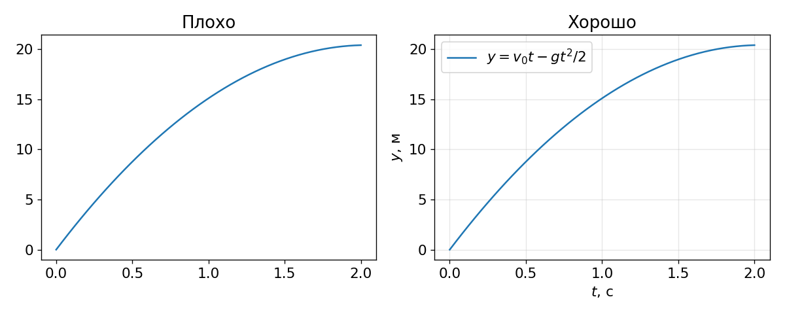
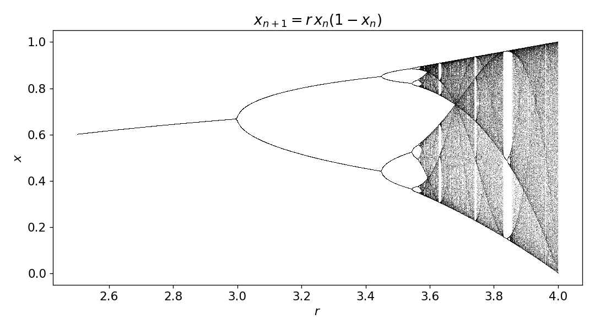
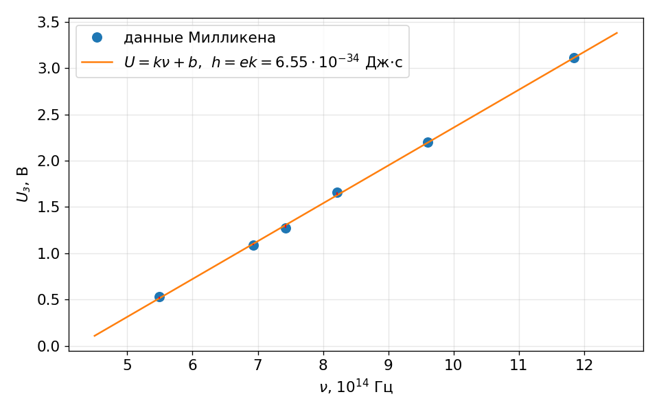
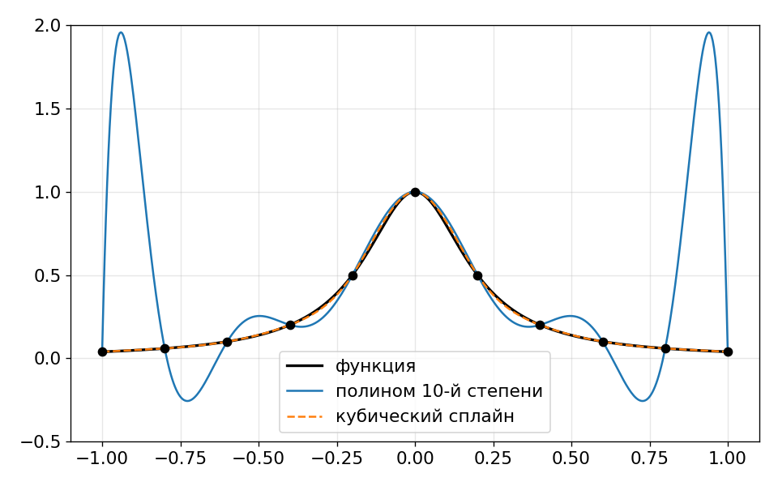

# Вычислительная физика с Python

## Занятие 1. Python как лабораторный инструмент

мини-курс для 10–11 классов

<!--
Представиться. Курс — 4 занятия по 3 часа. Сегодня больше всего «инструментов», дальше — физика.
-->

---

# Зачем физику компьютер?

- **1946, ENIAC** — один из первых электронных компьютеров — строили для расчёта таблиц артиллерийской стрельбы: траектория снаряда с сопротивлением воздуха не решается «на бумаге».
- **1953–55, Ферми, Паста, Улам, Цингу** — один из первых численных экспериментов: цепочка грузиков на нелинейных пружинах вела себя совсем не так, как ожидали.
- **Сегодня:** прогноз погоды, моделирование столкновений в коллайдере, поиск гравитационных волн в данных LIGO — всё это численные методы.

Три способа получать знание: **теория, эксперимент и вычислительный эксперимент**.

<!--
Спросить класс: какие задачи вы не умеете решать аналитически? Ожидаемые ответы: сопротивление воздуха, три тела, большие цепи. Отметить, что всё это будет в курсе.
-->

---

# План курса

| | Физика | Численный метод |
|---|---|---|
| 1 | Фотоэффект, маятник, пар | Обработка данных: МНК, интерполяция |
| 2 | Бросок под углом с сопротивлением | Дифференциальные уравнения, `sympy` |
| 3 | Электрические цепи, нелинейные элементы | Системы линейных уравнений, поиск корней |
| 4 | Идеальный газ, распределение Максвелла | Случайные числа, метод Монте-Карло |

Одна мысль на весь курс: **у задачи несколько путей решения**, и полезно уметь их сравнивать.

---

# Инструменты

- **Python** — простой язык, стандарт в научных вычислениях.
- **Jupyter Lab** — «лабораторный журнал»: код, текст, формулы и графики в одном документе.
- **numpy** — массивы и быстрая математика.
- **matplotlib** — графики.
- **scipy** — готовые численные методы: подгонка, интерполяция, ОДУ, корни уравнений.
- **sympy** — символьные вычисления, «формулы как на бумаге» (занятия 2–3).

Всё бесплатное и открытое.

<!--
Показать Jupyter Lab вживую: создать ячейку, Shift+Enter, текстовую ячейку с формулой $E = mc^2$.
-->

---

# Jupyter Lab: главное

- `Shift + Enter` — выполнить ячейку.
- `A` / `B` — новая ячейка выше / ниже, `M` — текст, `Y` — код.
- Число в `[ ]` — **порядок выполнения**. Именно он важен, а не порядок на экране!
- Запутались — *Kernel → Restart Kernel and Run All Cells*.

<!--
Частая ошибка: выполнили ячейку ниже раньше, чем ячейку с определением переменной, — NameError. Показать специально.
-->

---

# numpy: векторы вместо циклов

```python
L = np.array([0.25, 0.5, 1.0, 2.0, 4.0])
T = 2 * np.pi * np.sqrt(L / 9.81)    # сразу 5 периодов
```

- Операция применяется **к каждому элементу**.
- Миллион синусов: цикл Python — около 1 с, numpy — около 0,01 с.
- Код короче и похож на формулу из учебника.

<!--
В ноутбуке есть ячейка с замером времени — запустить вместе с классом, у всех будут свои числа.
-->

---

# Хороший график



Оси подписаны, **единицы указаны**, есть легенда.

<!--
Правило для всего курса: график без подписей осей не принимается.
-->

---

# Простое правило — сложное поведение



$x_{n+1} = r\,x_n(1 - x_n)$: устойчивость → удвоение периода → **хаос** при $r \approx 3{,}57$.

<!--
Один цикл и 10 строк кода — а получается картинка из книг о хаосе. Связь с «Играет ли Бог в кости?» Стюарта. Числа Фейгенбаума — для любопытных.
-->

---

# Фотоэффект: опыт Милликена

$$h\nu = A + eU_з \quad\Longrightarrow\quad U_з = \frac{h}{e}\,\nu - \frac{A}{e}$$

- Зависимость запирающего напряжения от частоты — **прямая**.
- Наклон $k = h/e$ → постоянная Планка.
- Милликен сомневался в квантах света, ставил опыт, чтобы проверить Эйнштейна, — и подтвердил его (1916).

<!--
Ученики 11 класса знают уравнение Эйнштейна, 10 класс — может, ещё нет. Хватит идеи: энергия фотона hν тратится на выход электрона и его кинетическую энергию.
-->

---

# Метод наименьших квадратов



$$S(k,b) = \sum_i (U_i - k\nu_i - b)^2 \to \min$$

Красные отрезки — отклонения. Ищем прямую с минимальной суммой их квадратов.

<!--
Вывести формулы для k и b на доске: две производные равны нулю → система двух линейных уравнений. Это хорошо знакомо по школьной алгебре. Получится h ≈ 6,55·10⁻³⁴ Дж·с — на 1 % ниже табличного.
-->

---

# Три способа одно и то же

1. **Формулы МНК вручную** — понимаем, что происходит.
2. `np.polyfit(x, y, 1)` — одна строка.
3. `scipy.optimize.curve_fit` — любая функция плюс **погрешности параметров**.

Результат: $h = (6{,}55 \pm 0{,}08)\cdot 10^{-34}$ Дж·с.

---

# Линеаризация

$$T = 2\pi\sqrt{\frac{L}{g}} \quad\Longrightarrow\quad T^2 = \frac{4\pi^2}{g}\,L$$

- Нелинейную зависимость превращаем в прямую заменой переменных.
- По наклону прямой $T^2(L)$ находим $g$.
- Если прямая не проходит через ноль, это подсказка о систематической ошибке (например, неверно измерена длина).

<!--
Вопрос классу: как линеаризовать закон Стефана–Больцмана P = σT⁴? Барометрическую формулу? (логарифм)
-->

---

# Интерполяция: что между точками?

- Таблица давления насыщенного пара, а нужно значение при 37 °C.
- **Линейная интерполяция** — соединяем точки отрезками.
- **Кубический сплайн** — гладкая кривая из кусочков кубических парабол.
- Обратная задача: при каком $t$ кипит вода на Эльбрусе ($p \approx 50$ кПа)? → около 81 °C.

---

# Осторожно: эффект Рунге



Полином через все точки «раскачивается». Таблицы интерполируем **сплайнами**, а экспериментальные данные **подгоняем** простой физической зависимостью.

---

# Мини-эксперимент: измеряем $g$

- Нить, гайка, рулетка, секундомер.
- Время **10 колебаний** для 5–6 длин от 20 см до 1 м.
- График $T^2(L)$ → МНК → $g$.
- Обсудим: чья группа ближе к 9,81 и почему?

<!--
Группы по 2–3 человека. 20–25 минут. Собрать результаты групп на доске — получится «распределение» значений g, хороший мостик к статистике на занятии 4.
-->

---

# Итоги

- Массивы `numpy` + графики `matplotlib` — основа всех следующих занятий.
- **МНК** — лучшая прямая через данные с ошибками.
- **Линеаризация** сводит нелинейные законы к прямой.
- **Интерполяция** — для таблиц, подгонка — для эксперимента.

**Домашнее задание:** период солнечного цикла по числам Вольфа с 1749 года.

**Почитать:** Дж. Тейлор, «Введение в теорию ошибок»; Дж. Элленберг, «Как не ошибаться».

**В следующий раз:** почему мяч летит не по параболе.
